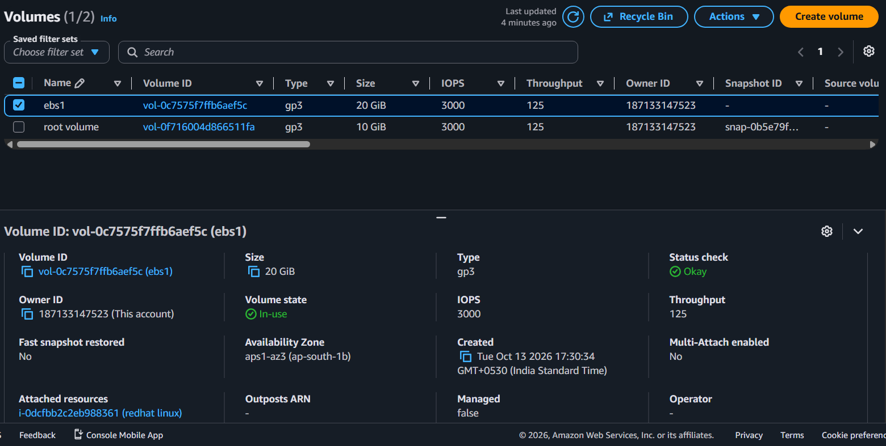
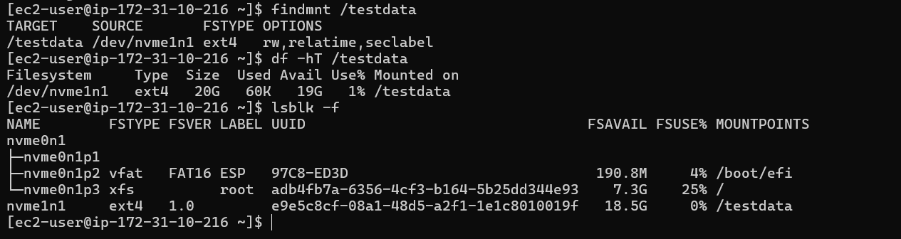
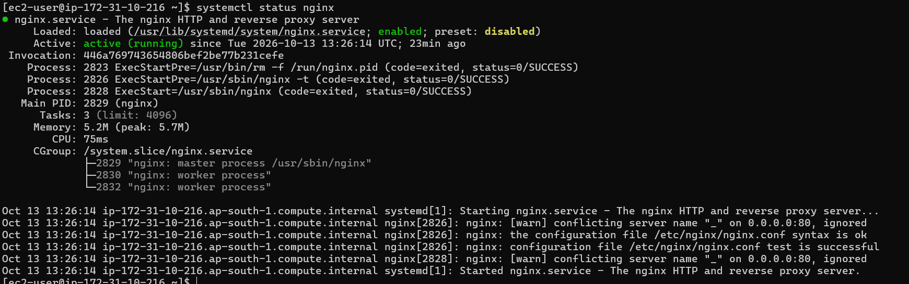
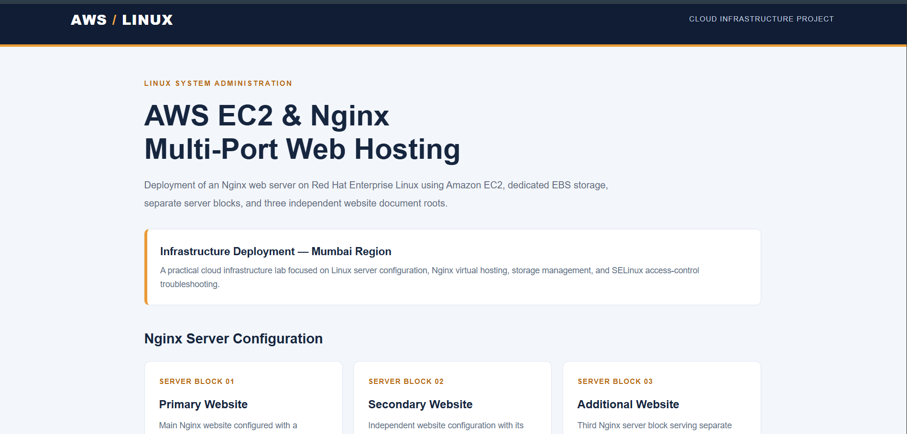
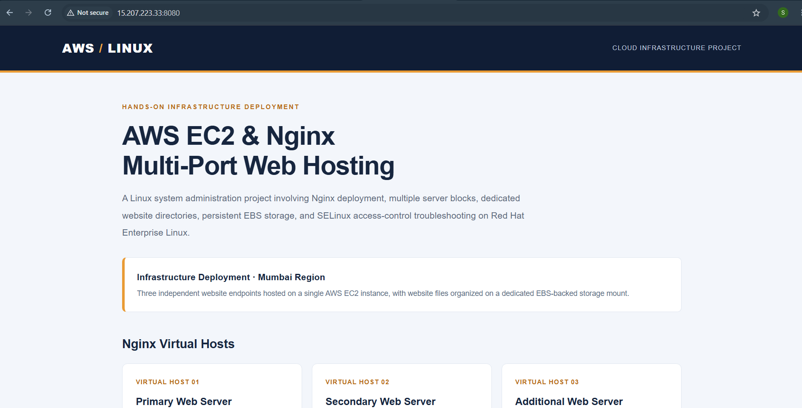
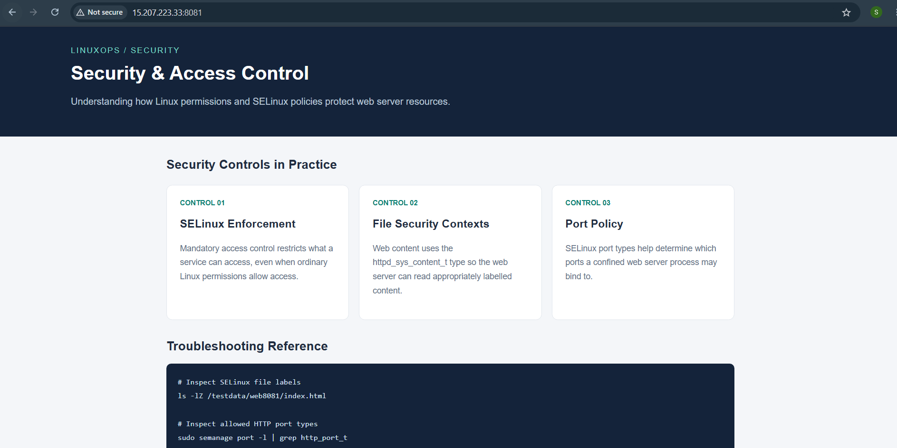

# AWS EC2 Nginx Multi-Port Web Hosting

## Project Overview

This project demonstrates hosting three separate HTML websites on a single Amazon EC2 instance running Red Hat Enterprise Linux in the AWS Mumbai Region (`ap-south-1`).

Nginx is configured with separate server blocks to serve each website on ports 80, 8080, and 8081. Website files are stored on a separate 20 GB gp3 Amazon EBS volume mounted at `/testdata`.

## Architecture

- **Cloud provider:** Amazon Web Services (AWS)
- **Region:** Mumbai (`ap-south-1`)
- **Compute:** Amazon EC2
- **Operating system:** Red Hat Enterprise Linux
- **Storage:** 20 GB gp3 EBS volume
- **Filesystem:** ext4
- **Mount point:** `/testdata`
- **Web server:** Nginx
- **Security:** EC2 Security Group rules and SELinux port configuration

## Project Structure

```text
aws-ec2-nginx-multi-port/
├── websites/
│   ├── web80/
│   │   └── index.html
│   ├── web8080/
│   │   └── index.html
│   └── web8081/
│       └── index.html
├── nginx/
│   └── websites.conf
├── screenshots/
└── README.md
```

## Implementation

1. Launched a Red Hat Linux EC2 instance in the Mumbai Region.
2. Created and attached a 20 GB gp3 EBS volume.
3. Formatted the volume with an ext4 filesystem and mounted it at `/testdata`.
4. Installed Nginx.
5. Created three separate HTML websites on the mounted volume.
6. Configured Nginx server blocks for ports 80, 8080, and 8081.
7. Configured EC2 Security Group inbound rules for the required web ports.
8. Troubleshot SELinux port permissions for custom HTTP ports.
9. Verified the Nginx service and website responses.

## Website Mapping

| Port | Website directory |
|---|---|
| 80 | `/testdata/web80` |
| 8080 | `/testdata/web8080` |
| 8081 | `/testdata/web8081` |

## Accessing the Websites

Replace `<EC2-PUBLIC-IP>` with the public IPv4 address of your EC2 instance.

- Port 80: `http://<EC2-PUBLIC-IP>/`
- Port 8080: `http://<EC2-PUBLIC-IP>:8080/`
- Port 8081: `http://<EC2-PUBLIC-IP>:8081/`

## Verification

The following checks are relevant to this project:

- Nginx service status
- EBS volume mount at `/testdata`
- Website availability on all three ports
- Different HTML content served by each port
- Security Group and SELinux configuration

Screenshots of successful verification will be added to the `screenshots/` directory.

## Skills Demonstrated

- AWS EC2 and EBS fundamentals
- Linux storage and filesystem management
- Nginx installation and virtual server configuration
- Multi-port web hosting
- AWS Security Group configuration
- SELinux troubleshooting
- Linux service verification and documentation

## Learning Outcome

This project provided hands-on practice with Linux server administration, cloud storage, web server configuration, and basic cloud-hosted website troubleshooting.

## 📸 Project Screenshots

### 1. EC2 Instance in Mumbai Region


### 2. EBS Volume Attached to EC2


### 3. EBS Volume Mounted at `/testdata`


### 4. Nginx Service Running


### 5. Website Running on Port 80


### 6. Website Running on Port 8080


### 7. Website Running on Port 8081



